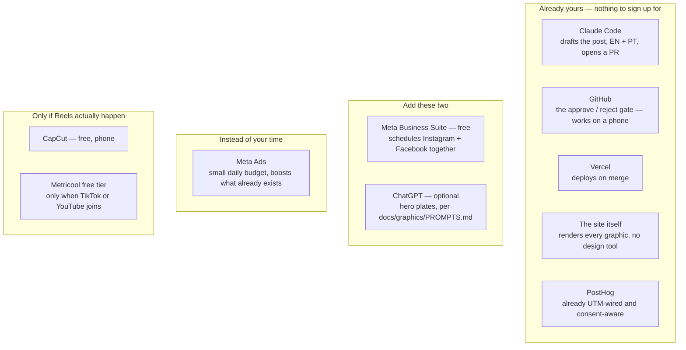
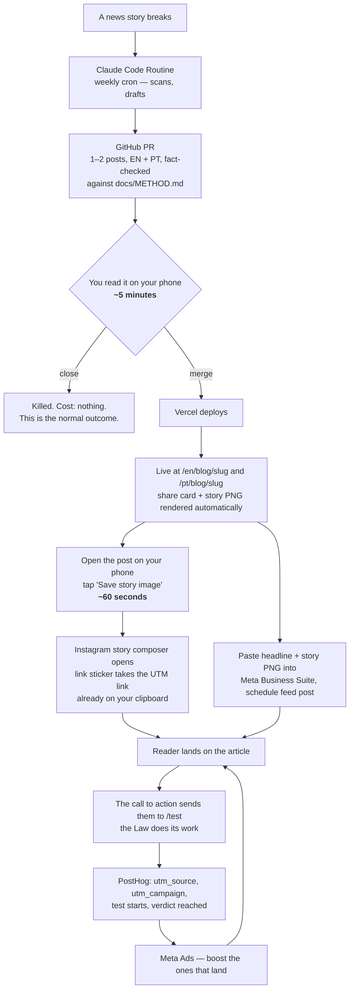

# Publishing to social, on no time

The governing constraint of this document is not reach, taste, or strategy. It
is that the owner has perhaps twenty minutes a week and some weeks has none.
Every decision below is downstream of that, and any plan that quietly assumes
otherwise has already failed — `src/lib/flags.ts` exists because exactly that
happened once already, and the blog went dark rather than half-tended.

So the test for anything here is not *is this good marketing*. It is **what
happens to this when a fortnight goes by and nobody touches it.** A plan that
degrades to nothing is a bad plan. A plan that degrades to a queue still
draining is a good one.

---

## The finding that reorders everything

**The pipeline is already built.** It was built for the blog and it was never
wired to a habit, so it looks like it is missing. It is not.

| Piece | Where it lives | State |
|---|---|---|
| News-hook article format, EN + PT, ending in a question | `src/content/blog/types.ts` | Done |
| 1080×1920 story graphic, generated per post | `src/app/[locale]/(content)/blog/[slug]/story/route.tsx` | Done, inside Instagram's safe zones |
| 1200×630 share card, generated per post | `.../[slug]/opengraph-image.tsx` | Done |
| One-tap hand-off to the Instagram story composer, with the UTM link pre-loaded on the clipboard for the link sticker | `src/components/blog/save-story-image-button.tsx` | Done |
| Stage-aware call to action — untested readers to `/test`, tested ones to the reading plan | `src/components/blog/personal-turn.tsx` | Done |
| UTM tagging, PostHog events, consent-free QR counter | `src/lib/blog-analytics.ts`, `src/app/go/[code]/route.ts` | Done |

**No design tool is needed to publish.** The site renders the graphic. That is
the single most important fact in this document, because image production is
the step that kills weekly habits, and it is already automated.

### Seven finished posts are sitting behind one line each

Eleven posts exist. Four are live. Seven carry `draft: true` and are complete in
both languages:

| Slug | Hook holds in September? |
|---|---|
| `the-country-that-banned-the-feed` | Yes — France, screens, children. Evergreen argument. |
| `a-pill-for-the-body` | Yes — longevity medicine. Evergreen. |
| `nobody-is-forecasting-you` | Yes — economic forecasting. Evergreen. |
| `a-law-about-dying` | Mostly — assisted dying legislation, still live news. |
| `four-in-twelve-days` | No — locked to a July cluster of deaths. |
| `seven-days-of-mourning` | No — locked to a specific mourning period. |
| `fifty-three-tickets` | No — locked to a July incident. |

That is **four posts ready to publish today**, costing one line each, plus three
that should stay drafts because a news hook decays and re-dating a stale one is
a lie the reader can check. Do not delete them; the flag comment's reasoning
applies — an unlinked draft costs no maintenance.

---

## You do not need to bring the blog back

This is worth stating precisely, because the worry is reasonable and the answer
is already in the code.

`BLOG_ENABLED` controls **three entrances only** — the header link, the footer
link, and the homepage's latest-post card. With the flag off, every published
post still renders, still carries its canonical URL and hreflang, still emits
its share card and story graphic, and stays in the sitemap.

**A social post can link straight to `/pt/blog/<slug>` with the flag off and
nothing about the site's navigation changes.** The reader arrives at the
article, reads it, and hits the call to action at the bottom, which sends them
to `/test`. They never see a blog section, because for them there isn't one —
there is one article that a friend or an ad handed them.

The blog as a *destination* stays closed. The posts serve as **landing pages for
the funnel**, which is the job they were shaped for anyway: every one ends in
`personalTurn`, an unresolved question aimed at the reader, with the test one tap
below it.

Flip `BLOG_ENABLED=true` only if the queue survives three months. It is a
promise to the reader, and it should be made after the habit exists, not to
create one.

---

## The tool chain

Everything in the first box is already paid for and already configured. The
second box is one free account and one you have. The third is the substitution
that makes this work on no time, and it gets its own section below.

---

## The loop

**Your total hands-on time per post: about six minutes**, and the five-minute
half of it is reading something on a phone, which can happen in a queue.

---

## Three tiers, and why the boring one matters most

### Tier 1 — the evergreen queue (the heartbeat)

One sitting a month, about thirty minutes, four posts scheduled. Sources, in
order of cheapness:

1. The evergreen drafts above — already written, one line to ship.
2. The fourteen `learn` topics — each already has a cover image and a question.
3. The death ticker — `1.8 people die every second` is a whole post on its own.

Scheduled in Meta Business Suite so they go out whether or not you open your
phone that week. **This tier is what makes the account exist between news
events.** An account that posts only when something happens looks abandoned, and
a news post landing on an abandoned account reaches nobody.

### Tier 2 — the news hook (the relevance)

Reactive, and rarer than instinct suggests — perhaps one a month, only when a
story is genuinely large. This is what the Claude Routine drafts.

The discipline that makes these work is already encoded in the post format: the
article is **about the news for four fifths of its length**, and then turns.
`personalTurn` is a required field precisely because a post without the turn is
commentary, and commentary converts nobody.

### Tier 3 — Reels (the only thing that reaches strangers)

This needs saying plainly rather than being buried, because the easy path above
has a ceiling built into it:

> **Stories reach people who already follow you. Feed posts mostly do too. On
> Instagram, Reels and paid distribution are what reach people who have never
> heard of the site.**

So the whole one-tap story pipeline — elegant as it is — distributes to an
audience that has to exist first. If the follower count is near zero, Tier 1 and
Tier 2 are talking to an empty room.

There are exactly two ways out, and one of them costs time you do not have.

---

## Buy the reach. Do not grind it.

Growing an Instagram audience organically is roughly three Reels a week for six
months. That is the honest number, and it is not available to someone with
twenty minutes a week. Pretending otherwise produces a dead account and a
demoralised owner, which is the state this document exists to avoid.

**The substitution: automate production, pay for distribution.**

- Production is already free and nearly instant — the site renders the graphics,
  Claude drafts the posts.
- Distribution is the expensive half, and money buys it directly. A small daily
  budget on Meta Ads against a post that already exists reaches more strangers in
  a week than a month of organic posting to a small account.
- The targeting is geography, language and behaviour, not belief. Meta removed
  religion as a targetable interest, so the practical audiences are Portugal and
  Brazil by language, broad age bands, and later a lookalike built from people
  who actually finished the test.

Start with one campaign, one objective (traffic to `/pt/test` or to a post),
and the smallest budget that buys usable data. Let PostHog say which creative
survives to the verdict screen, not which one got likes.

If a Reel ever does get made, make it the ad. One good vertical clip — the
question asked out loud, or a screen recording of somebody taking the test —
outperforms a still by a wide margin and can run for months.

---

## Where ChatGPT images fit, and where they do not

`docs/graphics/PROMPTS.md` is the existing discipline and it applies unchanged:
one prompt per fresh chat, the prompt recorded in that file **before** the image
lands, largest resolution PNG, raw — every treatment happens in code.

For social specifically:

- **Do not generate a per-post image.** The story route already composes title,
  hook and wordmark over the house background at the right size. Replacing that
  with a generated picture costs twenty minutes per post and loses the
  typographic consistency that makes a feed look like one thing.
- **Do generate the small number of reusable plates**: a vertical background for
  Reels, and a hero for any topic that gets its own campaign. These are drawn
  once and reused for months, which is the ratio that justifies the effort.
- **The exclusion list is load-bearing.** No gavels, no scales, no stock crosses,
  no text in the image. Text goes in code where it can be translated; an image
  with baked-in English is an image that cannot serve the PT half of the site.

---

## Copy rules for anything that goes out

These are not tone preferences. They are `docs/METHOD.md` applied to a surface
the reader meets **before** the site does, and getting them wrong wastes the
click.

1. **The hook is a question or a fact, never an offer of grace.** "Someone paid
   your fine" as an ad headline is grace handed to a reader the Law has not
   touched — a pearl before swine in Comfort's phrase, and a method error rather
   than a style one. The Law happens on the site. The ad only has to earn the
   tap.
2. **Mortality is a stake, not a lever.** The death counter is honest and it
   belongs in the funnel. It must not be staged as pressure at the moment of
   choosing.
3. **Nothing may suggest a tap saves.** No "click to be forgiven", no prayer in
   a caption. Conditional, and pointed at Christ.
4. **Committed vocabulary travels.** It is the **Test**. Never "The 180" — that
   is Comfort's 2011 documentary on a different subject entirely.
5. **Portuguese is `tu`**, and the fine in the grace flow is `dívida`.
6. **Specific beats general.** "Have you ever told a lie?" is the instrument.
   "Are you living right with God?" is the blunted version of the same sentence.

The `copy-review` skill is the checklist for a diff; run it before merging a
post PR the same way you would for any copy change.

---

## Measurement

Everything is wired, with one real gap.

Working today: UTM parameters on every share and story link, PostHog events for
shares, blog CTA clicks, test starts and verdicts, and an anonymous consent-free
counter for QR scans.

**The gap:** on-site analytics are consent-gated, so a reader who declines the
banner is invisible. The QR route solves this for print with a person-less
counter — two hundred scans against twelve consents is a campaign working and a
banner losing, and without the counter it looks identical to twelve scans. Paid
social has no equivalent, so today an Instagram campaign would be judged by
Meta's click count and very little else.

Closing it is small: the same anonymous counter, fired on arrival at a post or
at `/test` when a `utm_source` is present. Worth doing **before** spending money,
not after.

---

## What to build, in order

None of this is required to start. Ranked by hours saved per hour spent.

1. **Ship the four evergreen drafts.** One line each. Four posts, today.
2. **Anonymous landing counter for UTM arrivals**, mirroring the QR counter, so
   paid traffic is legible before it is paid for.
3. **A 1080×1350 feed route** beside the story route. Instagram's feed crops
   4:5; the 1200×630 share card is the wrong shape for it and the 1920-tall
   story wastes half its height. One more `ImageResponse`, same fonts and
   background.
4. **A `go` code per campaign** in `src/lib/go-links.ts`, so a bio link or an ad
   destination can be re-pointed later without editing the ad.
5. **The weekly Claude Routine** that scans the news and opens the PR. Last,
   because the three above make each post cheaper, and this one only makes posts
   more frequent. Frequency without cheapness is how the blog went quiet.
